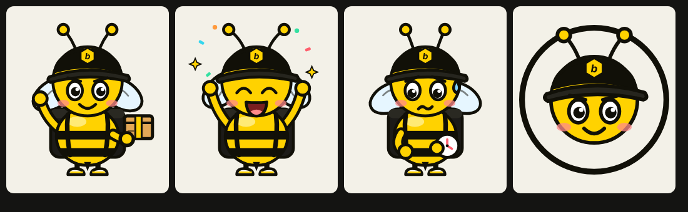

# Zum — mascote da bee Delivery

Abelha entregadora: boné da Bee, mochila térmica, tênis e pacote na mão. Cores da marca (`#FFD200` e `#111008`).

| Arquivo (`public/mascote/`) | Uso sugerido |
|---|---|
| `zum-acenando.svg` | Padrão: boas-vindas, telas vazias |
| `zum-comemorando.svg` | OTD dentro da meta, recorde do dia |
| `zum-preocupado.svg` | Atrasos, OTD abaixo da meta, falha na API |
| `zum-avatar.svg` | Ícone redondo: favicon, foto de perfil, WhatsApp |

Os SVGs são gerados por `gerar.mjs`. Para mudar cor ou pose, edite o script e rode:

    node painel-bee/mascote/gerar.mjs painel-bee/public/mascote

